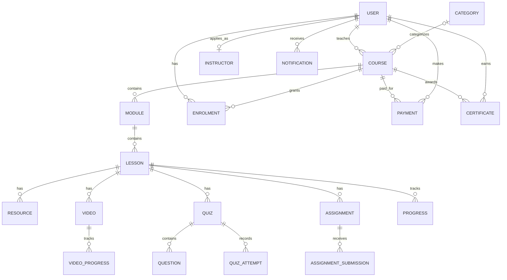
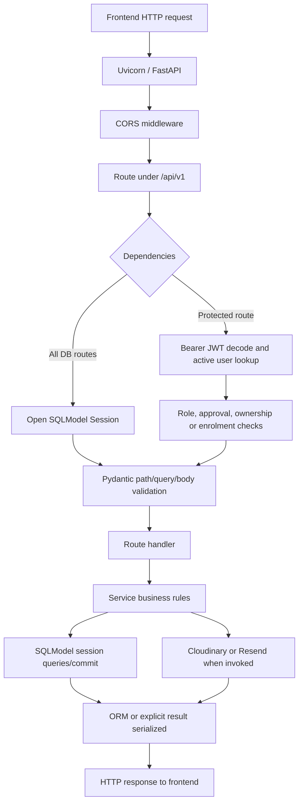

# Backend Technical Handover

This document describes the backend source currently present under `backend/`. It is based on code inspection; tests were not executed for this handover. Paths below are relative to `backend/` unless stated otherwise. Runtime behavior can still depend on environment settings and external Cloudinary/Resend accounts.

## 1. Project overview

The repository is the backend for the Online Computer Science Learning Platform (the configured API title defaults to “Cameroon CS Learning Platform API”). It provides student and teacher accounts, admin moderation, courses and lessons, assessments, enrolment, payments, learning progress, certificates, notifications, and Cloudinary-backed media access.

The confirmed architecture is a single FastAPI application with versioned routers, SQLModel table models and synchronous SQLAlchemy sessions, and service functions for selected workflows. PostgreSQL is the configured default database; SQLite is supported by the connection setup and used by tests. Clients call JSON HTTP endpoints under `/api/v1`; protected calls use bearer JWTs. Cloudinary is used for signed direct uploads and signed delivery URLs. Resend is optional for transactional email. MTN and Orange provider classes are adapter stubs; the working payment path is a development/test simulator.

This is a code description, not a claim that every feature is production-ready. No WebSocket, queue worker, scheduled task, Alembic migration, Docker, or hosting-provider configuration was found in the inspected backend tree.

## 2. Technology stack

Versions in `requirements.txt` are ranges, not a lockfile. The Python version is not pinned in the backend files.

| Technology | Evidence and actual role |
|---|---|
| FastAPI (`>=0.115,<1.0`) | App construction, routing, dependency injection, validation, OpenAPI and HTTP errors. |
| Uvicorn (`>=0.30,<1.0`) | ASGI server invoked by `run.py`. |
| SQLModel (`>=0.0.24,<1.0`) and SQLAlchemy | ORM models, metadata, query construction, synchronous sessions, and engine. |
| PostgreSQL / Psycopg 3 | Default database URL uses `postgresql+psycopg`; `psycopg[binary]` is required. SQLite connection arguments are handled for local/tests. |
| Pydantic and `pydantic-settings` | Request/response validation and environment-backed `Settings`. Pydantic major version is constrained indirectly by the FastAPI range; settings dependency is v2. |
| PyJWT | HS256 access and password-reset JWT encoding/decoding. |
| pwdlib with Argon2 extra | Recommended password hash and verify operations. |
| Cloudinary Python SDK | Signed upload parameters, metadata lookups/deletes, and protected download URLs. |
| Resend | Optional email delivery, imported dynamically only when an API key is configured. |
| ReportLab | Generates certificate PDFs in memory. |
| pytest and HTTPX | Test framework and FastAPI test client dependency. |
| `python-multipart` | Present as a dependency; current route upload flow uses direct client-to-Cloudinary signed uploads rather than FastAPI multipart endpoints. |

No separate repository/DAO layer exists. Routes call SQLModel sessions directly or delegate business rules to `app/services/`.

## 3. Backend folder structure

```text
backend/
├── .env                         # present; values intentionally not reproduced
├── .env.example                 # configuration template
├── .gitignore
├── requirements.txt
├── run.py                       # development Uvicorn launcher
├── docs/
│   └── README.md                # setup and operational notes
├── app/
│   ├── __init__.py
│   ├── main.py                  # FastAPI instance, lifespan, CORS, health route
│   ├── cli.py                   # interactive administrator bootstrap
│   ├── api/
│   │   ├── __init__.py
│   │   ├── router.py            # aggregates v1 routers
│   │   └── v1/                  # feature routers
│   │       └── __init__.py
│   ├── core/
│   │   ├── __init__.py
│   │   ├── config.py            # settings and production guards
│   │   ├── database.py          # engine, create_all, session dependency
│   │   ├── dependencies.py      # bearer token/current-user/session dependencies
│   │   ├── permissions.py       # role, ownership and approved-teacher checks
│   │   └── security.py          # password hashes and JWTs
│   ├── integrations/
│   │   ├── __init__.py
│   │   ├── cloudinary.py        # media provider operations
│   │   ├── email.py             # optional Resend delivery
│   │   └── payments/            # provider protocol, mock, MTN and Orange stubs
│   │       └── __init__.py
│   ├── models/                  # SQLModel persistence tables and relationships
│   │   └── __init__.py
│   ├── schemas/                 # Pydantic API input/output contracts
│   │   └── __init__.py
│   ├── services/                # feature workflows and business rules
│   │   └── __init__.py
│   └── utils/
│       ├── __init__.py
│       ├── file_validation.py   # local UploadFile validation helper
│       └── pdf_generator.py     # certificate PDF generation
└── tests/                       # pytest tests and SQLite fixture
```

The exact feature router modules are `admin.py`, `assignments.py`, `auth.py`, `certificates.py`, `courses.py`, `enrolments.py`, `instructors.py`, `lessons.py`, `modules.py`, `payments.py`, `progress.py`, `quizzes.py`, `resources.py`, `teacher.py`, `users.py`, and `videos.py` under `app/api/v1/`. There is no migration directory or deployment manifest in the tree inspected. The listing above omits generated/environment directories and does not enumerate individual model/schema files; these are inventoried below.

## 4. Application entry point and initialization

`run.py` calls `uvicorn.run("app.main:app", host="0.0.0.0", port=8000, reload=True)` when executed directly. The ASGI object is `app.main:app`.

`app/main.py` creates a FastAPI instance using configured title/debug settings and hard-codes API version metadata `1.0.0`. Its lifespan calls `create_db_and_tables()` before serving, then yields; no custom shutdown work is defined. Database setup imports `app.models` to register all tables and calls `SQLModel.metadata.create_all(engine)`. This creates missing tables but is not a schema migration mechanism and does not update existing table definitions.

The app registers CORS with comma-separated configured origins, credentials enabled, methods `GET`, `POST`, `PUT`, `PATCH`, `DELETE`, and headers `Authorization`, `Content-Type`. The aggregate router is mounted at `/api/v1`; `/health` is outside that prefix and returns `{ "status": "ok", "environment": <APP_ENV> }`.

There are no custom middleware or exception handlers in `main.py`. FastAPI handles request validation and `HTTPException`; unhandled errors follow framework defaults. Each request's `SessionDep` obtains a synchronous `Session` from `get_session()` and closes it at dependency teardown.

Request flow: server imports app/settings → lifespan creates missing tables → middleware (CORS) → `/api/v1` router match → dependencies resolve session and, where requested, user/role/ownership → FastAPI validates query/path/body → route and service execute → SQLModel objects or explicit dictionaries are serialized → response.

## 5. API architecture and endpoint inventory

All feature routes are included under `/api/v1`. OpenAPI is provided by FastAPI at `/docs` and `/openapi.json` by default; no custom schema settings are present. Pagination is ad hoc: course listing uses bounded `limit`/`offset`; admin lists cap values in handler code; other list routes often return all matching records or a fixed latest 100 notifications. There is no shared pagination envelope or common filtering/sorting convention.

Authentication notation: **Public** means no current-user dependency; **Bearer** means any active user; **Student**, **Admin**, and **Approved teacher/admin** refer to explicit role or approval guards. Some endpoints use `CurrentUser` but do not add a role guard; their exact ownership/access checks are summarized in the purpose column. Unless a response model is named, the return shape is the explicit Python object/dictionary or ORM model returned by that route, serialized by FastAPI.

### Health and authentication (`app/main.py`, `auth.py`)

| Method | Endpoint | Purpose; auth | Request → response | Implementation |
|---|---|---|---|---|
| GET | `/health` | Liveness; Public | none → `{status, environment}` | `main.health` |
| POST | `/api/v1/auth/register` | Student signup; Public | `RegisterRequest` (`email`, `full_name`, `password`) → `UserRead`, 201 | `auth.register` → `auth_service.register_student` |
| POST | `/api/v1/auth/register/teacher` | Teacher application/account; Public | `TeacherRegisterRequest` (registration fields plus `bio`, `qualifications`) → `TeacherRegistrationResponse`, 201 | `auth.register_teacher_account` → `register_teacher` |
| POST | `/api/v1/auth/login` | Login; Public | `LoginRequest` → `TokenResponse` (`access_token`, `token_type`) | `auth.login` |
| POST | `/api/v1/auth/logout` | Client-side logout; Bearer | none → 204 | `auth.logout`; no token revocation store |
| GET | `/api/v1/auth/me` | Current user and instructor review state; Bearer | none → `CurrentUserRead` | `auth.me` |
| PATCH | `/api/v1/auth/me` | Update display name; Bearer | `ProfileUpdate` (`full_name`) → `UserRead` | `auth.update_profile` |
| POST | `/api/v1/auth/password-reset/request` | Request reset; Public | email → generic message, 202 | `auth.request_password_reset`; emails token if active account exists |
| POST | `/api/v1/auth/password-reset/confirm` | Set password with reset JWT; Public | `{token,new_password}` → 204 | `auth.confirm_password_reset` |
| POST | `/api/v1/auth/password/change` | Change password; Bearer | `{current_password,new_password}` → 204 | `auth.change_password` |

### Courses, modules, and lessons (`courses.py`, `modules.py`, `lessons.py`)

| Method | Endpoint | Purpose; auth | Request → response | Implementation |
|---|---|---|---|---|
| GET | `/api/v1/courses/categories` | Active categories; Public | none → category list | `courses.categories` |
| GET | `/api/v1/courses` | Published course catalog with `q`, `category_id`, `limit` (1–100), `offset` | query → `CourseRead[]` | `courses.list_courses` |
| GET | `/api/v1/courses/{course_id}` | Published course detail; Public | path UUID → `CourseRead` | `courses.course_detail` |
| GET | `/api/v1/courses/mine` | Owned courses; Approved teacher/admin | none → `CourseRead[]` | `courses.my_courses` |
| POST | `/api/v1/courses` | Create draft course; Approved teacher/admin | `CourseCreate` → `CourseRead`, 201 | `courses.create` → `course_service.create_course` |
| PATCH | `/api/v1/courses/{course_id}` | Update owned course; owner/admin | full `CourseCreate` payload → `CourseRead` | `courses.update` → `update_course` (published course returns to draft) |
| POST | `/api/v1/courses/{course_id}/submit` | Submit draft/rejected course for review; owner/admin | none → `CourseRead` | `courses.submit_for_review` |
| POST | `/api/v1/courses/{course_id}/archive` | Archive eligible course; owner/admin | none → `CourseRead` | `courses.archive` |
| POST | `/api/v1/courses/{course_id}/review` | Approve/reject pending course; Admin | query `approved`, optional `reason` → `CourseRead` | `courses.review`, audit log and notification |
| GET | `/api/v1/courses/{course_id}/modules` | List modules; Bearer; unpublished courses hidden from students/non-owner | none → module list | `modules.list_modules` |
| POST | `/api/v1/courses/{course_id}/modules` | Create module; Approved teacher/admin and owner check | `ModuleCreate` → Module, 201 | `modules.create_module` |
| PATCH | `/api/v1/courses/{course_id}/modules/{module_id}` | Update module; owner/admin | `ModuleCreate` → Module | `modules.update_module` |
| GET | `/api/v1/modules/{module_id}/lessons` | List lessons; Bearer; non-enrolled students see previews only | none → `LessonRead[]` | `lessons.list_lessons` |
| POST | `/api/v1/modules/{module_id}/lessons` | Create lesson; Approved teacher/admin and owner check | `LessonCreate` → Lesson, 201 | `lessons.create_lesson` |
| PATCH | `/api/v1/lessons/{lesson_id}` | Update lesson; owner/admin | `LessonCreate` → `LessonRead` | `lessons.update_lesson` |
| GET | `/api/v1/lessons/{lesson_id}` | Read lesson content; Bearer with preview/enrolment/owner rules | none → `LessonRead` | `lessons.get_lesson` → `ensure_lesson_access` |

`CourseCreate` fields: title, slug, description, optional category UUID, level, `price_xaf`. `ModuleCreate`: title, description, position. `LessonCreate`: title, content, optional YouTube URL, duration, position, preview flag. Several mutation routes accept the same complete schema on PATCH, so they behave as full field assignments rather than sparse patch schemas.

### Enrolment and payments (`enrolments.py`, `payments.py`)

| Method | Endpoint | Purpose; auth | Request → response | Implementation |
|---|---|---|---|---|
| POST | `/api/v1/enrolments/{course_id}` | Free course enrolment; Student | path UUID → Enrolment, 201 | `enrolments.enrol` → `enrol_free_course` |
| GET | `/api/v1/enrolments/me` | Current user's enrolments; Bearer | none → Enrolment[] | `enrolments.my_enrolments` |
| POST | `/api/v1/payments` | Initiate paid course payment; Student | `PaymentInitiate` (`course_id`, provider `mtn|orange`, 9-digit phone) → id/reference/amount/currency/status/simulated, 201 | `payments.initiate` → `create_payment` |
| GET | `/api/v1/payments/me` | Payment history; Student | none → `PaymentRead[]` | `payments.my_payments` |
| POST | `/api/v1/payments/{payment_id}/verify` | Verify simulated payment in dev/test; Student and owner | none → `PaymentRead` | `payments.verify_test` → `verify_test_payment` |
| POST | `/api/v1/payments/{payment_id}/callback/{provider}` | Provider callback placeholder; no auth/signature validation | path only → always 501 | `payments.provider_callback` |

### Instructor/admin (`instructors.py`, `admin.py`, `teacher.py`)

| Method | Endpoint | Purpose; auth | Request → response | Implementation |
|---|---|---|---|---|
| GET | `/api/v1/instructors/applications` | Pending teacher applications; Admin | none → `InstructorAdminRead[]` | `instructors.pending` |
| GET | `/api/v1/instructors/registrations` | Registration history; Admin; optional status filter | query → `InstructorAdminRead[]` | `instructors.registrations` |
| GET | `/api/v1/instructors/registrations/{registration_id}` | Registration detail; Admin | path UUID → `InstructorAdminRead` | `instructors.registration_detail` |
| GET | `/api/v1/instructors/{user_id}/profile` | Approved instructor public profile; Public | path UUID → user id/name/bio/qualifications | `instructors.public_profile` |
| POST | `/api/v1/instructors/applications/{application_id}/review` | Approve/reject application; Admin | query `approved`, optional `reason` → `InstructorAdminRead` | `instructors.review` → service, audit, notification |
| GET | `/api/v1/teacher/dashboard` | Teacher metrics; Approved teacher/admin | none → course/student/pending review counts | `teacher.dashboard` |
| GET | `/api/v1/admin/users` | Recent users; Admin | optional `limit`, `offset` → `UserRead[]` | `admin.users` |
| GET | `/api/v1/admin/dashboard` | Aggregate counts; Admin | none → users/pending course/active enrolment/pending payment counts | `admin.dashboard` |
| GET | `/api/v1/admin/courses` | Course list with optional status filter; Admin | query → Course[] | `admin.courses` |
| PATCH | `/api/v1/admin/users/{user_id}/status` | Activate/deactivate user; Admin | query `active` → `{active}` | `admin.set_user_status`, audit entry |
| POST | `/api/v1/admin/categories` | Create category; Admin | `CategoryInput` (name, slug, description) → Category | `admin.create_category` |
| GET | `/api/v1/admin/audit-logs` | Recent audit records; Admin | optional limit → AuditLog[] | `admin.audit_logs` |

Admin router applies its administrator dependency to every route. Admin course review is instead mounted in the courses router and has an explicit admin check.

### Quizzes, assignments, progress, certificates, notifications (`quizzes.py`, `assignments.py`, `progress.py`, `certificates.py`, `users.py`)

| Method | Endpoint | Purpose; auth | Request → response | Implementation |
|---|---|---|---|---|
| POST | `/api/v1/quizzes/lessons/{lesson_id}` | Create quiz/questions; Approved teacher/admin and owner | `QuizCreate` with questions → summary dictionary, 201 | `quizzes.create_quiz` |
| GET | `/api/v1/quizzes/lessons/{lesson_id}` | List published quizzes; Bearer + lesson access | none → quiz summaries | `quizzes.list_lesson_quizzes` |
| POST | `/api/v1/quizzes/{quiz_id}/publish` | Publish non-empty quiz; Approved teacher/admin and owner | none → status | `quizzes.publish_quiz` |
| GET | `/api/v1/quizzes/{quiz_id}` | Quiz prompts and choices (not correct answers); Bearer + lesson access | none → quiz/question dictionary | `quizzes.get_quiz` |
| POST | `/api/v1/quizzes/{quiz_id}/attempts` | Submit quiz answers; Student | `QuizAnswer` (`answers`: question UUID to choice indexes) → attempt id/score/pass/time | `quizzes.submit_attempt` → `grade_quiz` |
| POST | `/api/v1/assignments/upload-signature` | Student's assignment upload signature; Student | none → Cloudinary signed parameters | `assignments.assignment_upload_signature` |
| POST | `/api/v1/assignments/lessons/{lesson_id}` | Create assignment; Approved teacher/admin and owner | `AssignmentCreate` → Assignment, 201 | `assignments.create` |
| GET | `/api/v1/assignments/lessons/{lesson_id}` | List assignments; Bearer + lesson access | none → Assignment[] | `assignments.list_lesson_assignments` |
| POST | `/api/v1/assignments/{assignment_id}/submissions` | Submit/replace ungraded submission; Student | text and/or file public id → Submission | `assignments.create_submission` → service |
| GET | `/api/v1/assignments/submissions/{submission_id}/file` | Download submission with ownership/teacher checks | none → 307 redirect to signed URL | `assignments.download_submission_file` |
| POST | `/api/v1/assignments/submissions/{submission_id}/grade` | Grade submission; Approved teacher/admin and course owner | score/feedback → Submission | `assignments.grade_submission` → service |
| GET | `/api/v1/assignments/me/submissions` | Student's submissions; Student | none → Submission[] | `assignments.my_submissions` |
| GET | `/api/v1/assignments/submissions/mine` | Teacher submissions for owned courses; teacher/admin role check | none → joined submission, assignment, student fields | `assignments.get_teacher_submissions` |
| PUT | `/api/v1/progress/lessons/{lesson_id}` | Update own lesson progress; Student | `LessonProgressUpdate` (`completed`, `last_position_seconds`) → lesson id/completed/position | `progress.update_lesson` → service prerequisites |
| GET | `/api/v1/progress/courses/{course_id}` | Course progress; Bearer; student must be enrolled, teacher must own course | none → course id/counts/percentage | `progress.get_course_progress` |
| POST | `/api/v1/certificates/courses/{course_id}` | Issue/retrieve certificate; Student, active enrolment and all lessons complete | none → Certificate | `certificates.issue` → service and notification |
| GET | `/api/v1/certificates/me` | Current user's certificates; handler requires student | none → certificate details plus course title | `certificates.get_my_certificates` |
| GET | `/api/v1/certificates/verify/{code}` | Verify certificate code; Public | path code → valid/name/course/date | `certificates.verify` |
| GET | `/api/v1/certificates/{certificate_id}/pdf` | Download own certificate, or any as admin | none → generated PDF bytes | `certificates.download` → ReportLab utility |
| POST | `/api/v1/certificates/{certificate_id}/revoke` | Revoke certificate; Admin | none → status | `certificates.revoke` |
| GET | `/api/v1/users/me/notifications` | Latest notifications for current user; Bearer | none → up to 100 Notification records | `users.notifications` |

`AssignmentCreate`: title, instructions, optional due time, positive max score. `AssignmentSubmit`: optional text and file public id, but service requires at least one. `AssignmentGrade`: nonnegative score and feedback. `QuizCreate` includes title, passing score, max attempts, and question definitions; correctness indexes are persisted but excluded from quiz read response. `LessonProgressUpdate` has a default `completed=false` and nonnegative position.

### Videos and resources (`videos.py`, `resources.py`)

| Method | Endpoint | Purpose; auth | Request → response | Implementation |
|---|---|---|---|---|
| POST | `/api/v1/videos/upload-signature` | Signed video upload parameters; Approved teacher/admin | none → signed parameter dictionary | `videos.signature` |
| POST | `/api/v1/videos/confirm` | Verify uploaded asset and attach to owned lesson; Approved teacher/admin | lesson id/public id → Video | `videos.confirm` → `video_service.confirm_upload` |
| GET | `/api/v1/videos/lessons/{lesson_id}` | List lesson videos; Bearer + lesson access | none → `VideoRead[]` | `videos.list_lesson_videos` |
| GET | `/api/v1/videos/{video_id}/playback` | Protected playback URL; Bearer + lesson access | none → signed URL, expiry, duration, format | `videos.playback_url` |
| PUT | `/api/v1/videos/{video_id}/progress` | Update playback progress; Student | position and optional client duration → saved position/watched/completed | `videos.progress` → service |
| GET | `/api/v1/videos/{video_id}/progress` | Resume position; Student + playback access | none → position/watched/completed | `videos.resume` |
| POST | `/api/v1/videos/{video_id}/retry` | Recheck asset metadata; Approved teacher/admin and owner | none → Video | `videos.retry` |
| DELETE | `/api/v1/videos/{video_id}` | Delete provider asset and mark deleted; Approved teacher/admin and owner | none → 204 | `videos.delete` |
| POST | `/api/v1/resources/upload-signature?kind=image\|document` | Signed resource upload parameters; Approved teacher/admin | query kind → signed parameter dictionary | `resources.signature` |
| POST | `/api/v1/resources/confirm` | Verify Cloudinary image/PDF and attach to lesson; Approved teacher/admin and owner | lesson/title/public id/type → Resource | `resources.confirm` |
| GET | `/api/v1/resources/lessons/{lesson_id}` | List ready resources with expiring download URLs; Bearer + lesson access | none → resource metadata and signed URL | `resources.list_lesson_resources` |

The browser uploads bytes directly to Cloudinary after requesting signatures; backend confirmation looks up canonical asset metadata, validates scope/location, size and allowed format, and persists metadata. The backend does not stream video uploads through FastAPI.

## 6. Database architecture

### Connection and lifecycle

`app/core/database.py` creates a synchronous SQLModel engine from `DATABASE_URL`, with `echo=settings.debug` and `pool_pre_ping=True`. SQLite URLs receive `check_same_thread=False`. `get_session()` yields a `Session` in a context manager. Most route/service functions explicitly `commit()`, and writes often `refresh()` afterward. No common transaction middleware or repository abstraction was found.

On startup, all imported SQLModel metadata is passed to `create_all`. No Alembic files or migration history were found. Consequently, `create_all` will not evolve an existing database schema after model changes.

### Model inventory

All primary keys are UUIDs generated in Python unless indicated. Most timestamps use timezone-aware UTC defaults. Exact constraints/relationship declarations live in the referenced model files.

| Model (file) | Fields and relationships | Feature |
|---|---|---|
| `User` (`models/user.py`) | id, unique indexed email, full_name, password_hash, role, is_active, password_changed_at, created/updated; relationships to courses, enrolments, payments, certificates, progress, notifications, optional instructor profile | Identity and ownership |
| `Instructor` (`instructor.py`) | id, unique user_id FK, bio, qualifications, status, review reason, reviewer FK, review timestamp; user relationship | Teacher application/moderation |
| `Category` (`category.py`) | id, unique indexed name/slug, description, is_active; courses relationship | Course catalog taxonomy |
| `Course` (`course.py`) | id, instructor FK, optional category FK, title, unique indexed slug, description, level, nonnegative XAF price, status, rejection reason, timestamps; instructor/category/modules/enrolments/payments/certificates relationships | Course lifecycle |
| `Module` (`module.py`) | id, course FK, title, description, position; course/lessons relationships | Course structure |
| `Lesson` (`lesson.py`) | id, module FK, title, content, optional YouTube URL, nonnegative duration/position, preview flag; module/resources/videos/quizzes/assignments/progress relationships | Lesson content |
| `Resource` (`resource.py`) | id, lesson and uploader FKs, title/type, Cloudinary public id/secure URL, MIME, size, status, creation time; lesson relationship | PDF/image lesson attachments |
| `Video` (`video.py`) | id, lesson/uploader FKs, provider, public id/URL, format, size/duration/status/timestamp; lesson and video-progress relationships | Video metadata |
| `VideoProgress` (`video.py`) | id, video/student FKs, current/furthest positions, watched seconds, completion, updated time; unique `(video_id, student_id)` | Playback tracking |
| `Quiz` (`quiz.py`) | id, lesson FK, title, passing score, max attempts, published; lesson/questions/attempts | Assessments |
| `Question` (`quiz.py`) | id, quiz FK, prompt, type, JSON choices and correct answer indexes, points, position; quiz relationship | Quiz questions/answer key |
| `QuizAttempt` (`quiz.py`) | id, quiz/student FKs, JSON answers, score, passed, submitted time; quiz relationship | Student assessment results |
| `Assignment` (`assignment.py`) | id, lesson FK, title/instructions, optional due time, max score; lesson/submissions | Coursework |
| `AssignmentSubmission` (`assignment.py`) | id, assignment/student FKs, text/file metadata, score/feedback/status/times; unique `(assignment_id, student_id)`; assignment relationship | Submitted and graded work |
| `Enrolment` (`enrolment.py`) | id, student/course FKs, status, enrolled time; unique `(student_id, course_id)`; student/course relationships | Access grants |
| `Payment` (`payment.py`) | id, student/course FKs, provider, phone, unique provider/reference pair, positive amount, currency/status/simulated flag, timestamps; student/course relationships | Payment records |
| `Progress` (`progress.py`) | id, student/course/lesson FKs, completed, position, timestamp; unique `(student_id, lesson_id)`; student/course/lesson relationships | Lesson completion state |
| `Certificate` (`certificate.py`) | id, student/course FKs, unique code, optional PDF URL, revoked, issue time; unique student/course pair and relationships | Course completion certificate |
| `Notification` (`notification.py`) | id, user FK, title/message/read/time; user relationship | In-app messages |
| `AuditLog` (`audit_log.py`) | id, optional actor FK, indexed action, entity type/id, details, timestamp | Administrative audit events |

Important graph: User teaches Courses; a Course optionally has a Category and contains Modules → Lessons. Lessons may have Resources, Videos, Quizzes → Questions/Attempts, Assignments → Submissions, and Progress rows. Users enrol in Courses and have Payments, Progress, Certificates, and Notifications. Instructor is a separate one-to-one profile keyed to User. Several logical references (for example `Video.uploaded_by`, `Resource.uploaded_by`, quiz attempt `student_id`, and assignment submitter) are FKs without ORM relationship attributes.



The diagram includes declared foreign-key relationships; not every FK has a declared ORM navigation property. There are no explicit soft-delete fields; statuses such as `archived` or `deleted` are used for some entities. State fields such as role/status/provider/question type are plain strings, not Python enums or DB enum constraints.

## 7. Authentication and authorization

Passwords are hashed using `pwdlib.PasswordHash.recommended()`; verification returns false on invalid hash input. Registration normalizes email and hashes passwords. Public `/auth/register` always creates a student; teacher registration creates a `User(role="teacher")` plus a pending `Instructor` record, but authoring is blocked until profile approval. Admin creation is CLI-only (`app/cli.py`), requiring a password of at least 10 characters and refusing duplicate/non-admin email reuse.

Login returns an HS256 JWT with `sub` user UUID, `pwd` password-change timestamp snapshot, and `exp` based on `ACCESS_TOKEN_EXPIRE_MINUTES` (default 60). The bearer dependency decodes it, reloads active user, and compares the token's password version claim to `password_changed_at`; password change/reset invalidates previously issued tokens. Logout is stateless: it only authenticates the caller and expects the client to discard the token. There is no refresh token or server-side revocation table.

Password reset request returns the same generic message whether a user exists. If the active account exists, a purpose-tagged, expiring JWT is emailed by Resend. Confirm verifies purpose and expiry, and uses `iat` against `password_changed_at` to reject a reused token. Password-change and reset lengths are 10–128; reset-token lifetime defaults to 30 minutes.

Roles observed in code are `student`, `teacher`, and `administrator`. `require_roles` enforces exact values. `require_approved_teacher_or_admin` permits admins or a teacher with an `Instructor(status="approved")` record. `ensure_course_owner` permits admins globally and approved teachers only for their own course. `ensure_lesson_access` allows admins, approved owners, published preview lessons, or active student enrolments. Some handlers have specific narrower checks documented in the endpoint inventory. Role fields are strings, and several access rules are hand-coded in route/service functions.

## 8. Business logic and feature modules

| Feature | Main files and implemented rules |
|---|---|
| Account/auth | `api/v1/auth.py`, `services/auth_service.py`, `core/security.py`: student/teacher signup, login, profile, password reset/change, JWT enforcement. |
| Teacher applications | `models/instructor.py`, `api/v1/instructors.py`, `services/instructor_service.py`: pending/approved/rejected states; admin review records actor/time/reason and audit log; teachers can log in while pending/rejected but cannot author. |
| Course catalog and moderation | `api/v1/courses.py`, `services/course_service.py`: public published catalog, search/category filters, teacher-owned course CRUD, draft→pending review→published/rejected, archive. Updating a published course returns it to draft. Admin course review sends notification and writes an audit row. |
| Curriculum | `api/v1/modules.py`, `api/v1/lessons.py`: position-ordered module/lesson management, preview lesson policy, owner checks. |
| Enrolment | `services/enrolment_service.py`: free published courses enroll directly; paid courses reject free enrollment; existing inactive record is reactivated. Payment verification also creates/reactivates enrollment. |
| Payments | `services/payment_service.py` and integration adapters: simulator can verify allowlisted test numbers only in development/test; successful verified payment grants active enrollment. Real MTN/Orange not implemented end-to-end. See Section 9. |
| Video | `services/video_service.py`, Cloudinary integration: upload confirmation checks owner scope, provider metadata, formats and size; playback requires `ready` and lesson access; progress tracks current/furthest position, estimated watched time, and completion threshold. Retry/delete actions require course owner/admin. |
| Resources and assignment files | `api/v1/resources.py`, `services/assignment_service.py`, Cloudinary: signed direct uploads, metadata and scope validation, PDF/image restrictions and signed downloads. `utils/file_validation.py` is a separate local-upload helper not referenced by these endpoints. |
| Assignments | `api/v1/assignments.py`, `services/assignment_service.py`: submit text/file, one unique submission per student and assignment, ungraded resubmission allowed, graded replacement rejected, course-owner grading, student notification. Due date is stored but service does not enforce it. |
| Quizzes | `api/v1/quizzes.py`, `services/quiz_service.py`: instructor creates questions, validates types/indexes, publishes non-empty quizzes, limits attempts, scores exact choice-set matches. Correct answers are withheld from read endpoint. |
| Learning progress | `api/v1/progress.py`, `services/progress_service.py`: completion checks require each ready video marked complete, each published quiz passed, and each assignment submitted. Course percentage is completed lessons divided by total lessons. |
| Certificates | `services/certificate_service.py`, `utils/pdf_generator.py`: requires published course, active enrollment, at least one lesson, and completion of all lessons; unique code, revocation, public verification, generated PDF. `pdf_url` is not populated by issuance. |
| Notifications/email | `services/notification_service.py`, `integrations/email.py`: in-app row is persisted; optional email attempted via Resend. No notification read/update endpoint was found. |
| Admin/audit | `api/v1/admin.py`, `models/audit_log.py`: dashboard counts, user activation, course/category listing/creation, log listing. Audit records are written for user status, course review, teacher review; not for every state-changing operation. |
| Analytics | Basic count summaries exist in admin and teacher dashboards. No broader analytics/reporting module found. |

Implementation presence should not be confused with external production readiness. External services, provider contracts, runtime configuration, and deployed database behavior were not independently verified.

## 9. Payment system

`Payment` stores student/course, provider label, phone number, provider reference, amount XAF, currency (default XAF), status (default pending), `is_simulated`, creation and verification times. Provider/reference has a unique constraint. `PaymentInitiate` accepts only `mtn` or `orange` and a 9-digit phone.

In `development`, `dev`, or `test` with `PAYMENT_MODE=mock`, initiation creates a deterministic simulated intent and pending payment without contacting a telco. The mock adapter recognizes a fixed development allowlist (`678241562`–`678241565` in the mock source). Verification is only available on the authenticated `/payments/{id}/verify` route and only to the owning student. It checks simulated state, published course, XAF currency and amount equality with current course price, and the mock number. Failure marks payment failed and creates no enrollment. Success marks it succeeded, timestamps it, activates or creates enrollment, commits, then notifies.

For other modes, service code selects MTN when provider is `mtn`, otherwise Orange. Those adapters currently return 503 if credentials are absent and 501 even when present because merchant product initiation is not implemented. Their callback methods are also 501 placeholders. The public callback route itself always returns 501 and does not validate a provider signature. Thus no real callback can currently grant access, and production startup rejects mock mode.

Payment risks/status: payment success and enrollment are committed in one session transaction, but notification is a later commit/action. Real-provider amount/reference/signature verification remains unimplemented. The expected rule “no access before verified payment” is supported by the free-enrolment price guard and simulator verification path, but has not been verified against a live provider because none exists.

## 10. File uploads and storage

`services/cloudinary_service.py` maps upload purposes (`video`, resource image/document, assignment, plus course thumbnail/profile/lesson image purposes) to server-controlled subfolders and resource types. Signatures are created with authenticated delivery type. Fixed-folder mode uses Cloudinary `folder`; dynamic mode sends `asset_folder` and `public_id_prefix`. Configuration validates folder syntax, asset public ID prefix, and, for dynamic mode, provider-reported folder. Confirmation checks format and configured byte size before storing metadata. Signed delivery defaults to 300 seconds.

Supported endpoint upload types currently include videos (`mp4`, `webm`, `mov`, `m4v`), resource images (`jpg`, `jpeg`, `png`, `webp`), and documents/assignment files (PDF/raw format). Video/resource data is uploaded by the frontend directly to Cloudinary; `secure_url` is stored but protected playback/resource endpoints return a newly signed delivery URL. Provider operations fail with HTTP errors when Cloudinary is unconfigured or operations fail.

`utils/file_validation.py` checks MIME, magic header and size for a FastAPI `UploadFile`, but no current API endpoint calls it. The presence of multipart dependency/helper does not establish a backend upload endpoint.

## 11. Background tasks and real-time behavior

No queue, worker, scheduler, task broker, WebSocket route, or event-stream implementation was found. Email sends are synchronous from service execution. Video processing status is represented as `processing`/`ready` and can be rechecked with an explicit retry endpoint; no background polling worker is included. Frontend polling may be used, but backend source alone cannot confirm client behavior.

## 12. Errors and logging

Routes/services raise FastAPI `HTTPException` with status and detail for expected failures; request schema errors use FastAPI/Pydantic 422 behavior. Notable statuses include 401 invalid credentials, 403 permission/access failures, 404 hidden/missing records, 409 invalid state/duplicate conflict, 413 size limit, 415 type rejection, 501 unfinished provider callbacks/adapters, 503 missing external configuration, and 204 for successful no-body operations. No shared error envelope or custom exception mapping was found, so standard FastAPI `{ "detail": ... }` applies to these errors.

Email integration logs skipped delivery and exceptions. Cloudinary wrappers convert provider exceptions to HTTP errors. There is no configured structured request logging, tracing, metrics, or error reporting integration visible in the backend source.

## 13. Logging and observability

The only explicit application logger is in `services/notification_service.py` and the Resend integration. The development Uvicorn launcher has reload enabled. No logging configuration, metrics endpoint, tracing, or health dependency check is defined. `/health` reports process-level status and configured environment; it does not probe PostgreSQL or Cloudinary.

## 14. Configuration and environment variables

`core/config.py` uses `pydantic-settings` to load `.env` from the process working directory, with case-insensitive environment naming behavior from settings defaults. Unknown keys are ignored. Defaults below are from the `Settings` class; `.env.example` may document optional semantics. Do not copy actual `.env` values into documentation or logs.

| Variable | Purpose | Required | Default |
|---|---|---|---|
| `APP_NAME` | FastAPI title | No | `Cameroon CS Learning Platform API` |
| `APP_ENV` | Environment label and security/payment mode checks | No | `development` |
| `PAYMENT_MODE` | `mock` or non-mock provider selection behavior | No | `mock` |
| `DEBUG` | FastAPI debug and SQL echo | No | `false` |
| `CORS_ORIGINS` | Comma-separated allowed origins | No | `http://localhost:5173` |
| `SECRET_KEY` | HS256 access/reset signing key | Required for secure deployment; validator enforces 32 chars outside default in prod | Development placeholder (do not use in production) |
| `DATABASE_URL` | SQLModel engine connection URL | No in code; production DB must be configured | PostgreSQL localhost URL `postgres/postgres`, db `learning_platform` |
| `ACCESS_TOKEN_EXPIRE_MINUTES` | Access-token lifetime | No | `60` |
| `PASSWORD_RESET_EXPIRE_MINUTES` | Reset-token lifetime | No | `30` |
| `CLOUDINARY_CLOUD_NAME` | Cloudinary account | Optional until media features used | unset |
| `CLOUDINARY_API_KEY` | Cloudinary API key | Optional until media features used | unset |
| `CLOUDINARY_API_SECRET` | Cloudinary signing secret | Optional until media features used | unset |
| `CLOUDINARY_UPLOAD_FOLDER` | Root folder | No | `learning-platform` |
| `CLOUDINARY_FOLDER_MODE` | fixed or dynamic folder behavior | No | `fixed` |
| `CLOUDINARY_MAX_IMAGE_SIZE` | Image upload byte limit | No | 10 MiB |
| `CLOUDINARY_MAX_DOCUMENT_SIZE` | Document/assignment byte limit | No | 20 MiB |
| `CLOUDINARY_MAX_VIDEO_SIZE` | Video upload byte limit | No | 500 MiB |
| `RESEND_API_KEY` | Resend email API key | Optional | unset (delivery skipped) |
| `EMAIL_FROM` | Sender identity | No | `Learning Platform <noreply@example.com>` |
| `MTN_API_BASE_URL`, `MTN_API_KEY`, `MTN_SUBSCRIPTION_KEY` | Future MTN adapter configuration | Optional until live adapter is implemented | unset |
| `ORANGE_API_BASE_URL`, `ORANGE_CLIENT_ID`, `ORANGE_CLIENT_SECRET` | Future Orange adapter configuration | Optional until live adapter is implemented | unset |

Production validator rejects the default/short secret and `PAYMENT_MODE=mock`; folder mode must be `fixed` or `dynamic`. No production CORS allowlist enforcement beyond configured origins was found.

## 15. Database migrations

No Alembic dependency/configuration, migration directory, or migration scripts were present in the backend tree. Schema setup currently relies on `SQLModel.metadata.create_all(engine)` at application startup and tests explicitly drop/create metadata. `create_all` can add absent tables but does not modify existing tables/columns/constraints. There is no source-backed command to generate/apply migrations. Treat model changes against persistent environments as requiring a separately designed and reviewed migration process; do not assume startup updates schema.

## 16. Security architecture

Implemented controls include password hashing, password reset purpose/expiry, JWT signature/expiry validation, password-change token invalidation, active-account check, explicit role guards, course-owner checks, approved teacher checks, lesson enrollment/preview restrictions, Cloudinary signed uploads and time-limited delivery, upload scope/format/size checks, no correct-answer exposure on quiz read, generic reset-request response, and production checks for secret/payment mode.

Areas requiring care or further review from source inspection:

- `SECRET_KEY` has a development fallback. Production validator blocks the known default and short keys, but secure deployment still depends on secret provisioning and environment handling.
- Access tokens are stateless and logout does not revoke a token; compromise remains effective until expiry/password change/account deactivation.
- The public certificate verification response returns student name and course title for a valid code; confirm that disclosure matches product/privacy expectations.
- The course progress route accepts a current user and explicitly checks enrollment for students and ownership for teachers, but its authorization branches should be reviewed if adding other role types.
- `assignments.get_teacher_submissions` accepts teacher/admin by a hand-coded role check and filters records by `Course.instructor_id == user.id`; admins therefore see only courses attributed to their own user ID in this query, unlike a global admin view.
- Provider callback endpoint has no authentication/signature verification but currently always fails closed with 501. Do not enable access-grant behavior there without verified provider signatures, replay protection, amount/currency/reference binding, and idempotency review.
- Notification/email delivery is synchronous. The in-app insert commits before sending email; delivery failure is swallowed by Resend wrapper.
- Many role/status values are free-form strings; consistency is enforced in application logic, not DB enums.
- Upload endpoints rely on provider metadata and public ID scoping; maintain that verification when adding new purposes. `file_validation.py` is not currently wired to route inputs.
- No rate limiting was found for login, reset requests, or other public endpoints.
- No custom security headers, CSRF controls, or request-size middleware are configured in this app file; the relevance depends on deployment/proxy topology and client usage.

These are source-level observations and review items, not exploit validation. No security testing was performed.

## 17. API request lifecycle



The exact ordering among independent FastAPI dependencies may be framework-managed, but the route's dependencies must succeed before handler execution. Sessions are synchronous even though FastAPI supports async handlers elsewhere.

## 18. Frontend/backend integration

Backend base prefix is `/api/v1`; `/health` is the only identified route outside that prefix. Protected requests use `Authorization: Bearer <access_token>`. JSON request schemas are defined in `app/schemas/` and inline route models. Successful responses vary between ORM serialization, explicit dictionaries, lists, and empty 204 responses; there is no common envelope. Expected errors use FastAPI `detail` structures. Pagination is endpoint-specific, and no backend-wide pagination response object exists.

Uploads use a two-step contract: obtain signed Cloudinary parameters from backend, upload directly to Cloudinary using returned URL/resource type and fields, then send returned public ID to a backend confirmation endpoint. Playback and resource download URLs expire after approximately 300 seconds. Payment flow in dev/test: initiate → call authenticated verify endpoint → check status; only succeeded verification grants enrolment. For free courses use enrolment endpoint directly.

No frontend source was inspected for this task, so compatibility with current client paths/payloads is not asserted here. Contract fields should be checked against both `api/v1` route handlers and relevant `schemas/` before client changes. The separate backend `docs/README.md` says teacher applications use `/instructors/applications`; actual public teacher signup is `/auth/register/teacher`, while `/instructors/applications` is the admin list route. Treat source router as authoritative and resolve this documentation discrepancy when maintaining docs.

## 19. Testing

The test suite uses pytest and FastAPI `TestClient` (`httpx`). `tests/conftest.py` defaults `DATABASE_URL` to `/tmp/learning-platform-tests.db`, sets test secret/environment before importing app, disables email, and drops/recreates SQLModel tables around tests. Existing tests cover auth/signup, course permissions, free enrollment/payment separation, simulated payments and tamper checks, quiz answer privacy/attempt cap, teacher review/ownership, Cloudinary upload signing/scope, and video auth/processing state.

There are no explicit test files for certificates, assignments, notifications, resources route behavior, password reset/change, broad admin operations, or real provider adapters. No coverage configuration or recorded coverage report was found. Tests were not run during this documentation task, so pass status is unverified.

From `backend/`, after installing the listed requirements and configuring dependencies, the existing suite is invoked with `pytest`. Test fixture defaults may only apply before importing the app; overriding `DATABASE_URL` should likewise occur before app import. Avoid pointing tests at a non-test database because fixture drops all mapped tables.

## 20. Running locally

Based on `backend/docs/README.md` and actual `run.py`:

```sh
cd backend
python3 -m venv .venv
source .venv/bin/activate
pip install -r requirements.txt
cp .env.example .env
# Create PostgreSQL database `learning_platform` and configure DATABASE_URL.
python run.py
```

The Python version is unspecified; select a version compatible with installed FastAPI/SQLModel/Pydantic dependencies. The database must be reachable before app startup because lifespan calls table creation. Cloudinary is needed for upload/media operations; Resend is optional. Visit `http://localhost:8000/docs`; health is `http://localhost:8000/health`.

Create an administrator interactively from the backend directory with:

```sh
python -m app.cli create-admin admin@example.com "Platform Administrator"
```

The CLI prompts for a hidden password and requires at least 10 characters. It also invokes `create_db_and_tables()`. These are setup instructions only; no database commands were run for this handover.

## 21. Deployment architecture

No Dockerfile, compose file, Procfile, platform manifest, production Uvicorn/Gunicorn command, or hosting-provider configuration was found. Confirmed runtime command is the development launcher with reload enabled, which should not be treated as a production deployment recipe. The app binds `0.0.0.0:8000`. Production requires external configuration of database URL, strong secret, non-mock payment mode, CORS origins, and credentials for any enabled integrations. Static files are not served by the backend. Cloudinary stores media; DB keeps provider identifiers and metadata.

## 22. Implementation status

| Feature | Status | Evidence |
|---|---|---|
| Student auth/JWT | Implemented | Signup/login/current user/password update and JWT dependencies exist. |
| Teacher applications and admin review | Implemented | Pending/approved/rejected flow, audit and tests present. |
| Course/curriculum authoring and review | Implemented | Routers, models and ownership/status transitions exist. |
| Student enrolment | Implemented | Free course service and verified simulated paid flow. |
| Payment simulator | Mocked | Deterministic development/test adapter and guarded verify endpoint. |
| Real MTN/Orange payment | Incomplete | Adapter classes are explicit 501 boundaries; callback does not verify. |
| Cloudinary uploads/playback/resources | Implemented, external config dependent | Signature, metadata confirmation and signed delivery logic exists; account/runtime not verified. |
| Quizzes and grading | Implemented | Creation/publish/attempt caps/scoring service exists. |
| Assignments and grading | Implemented | Submission, ownership grading and Cloudinary file flow exist; due time not enforced. |
| Lesson/video progress | Partially implemented | Progress and completion gates exist; video watch time is inferred from client position/time and includes end-position shortcut. |
| Certificates | Implemented | Eligibility, unique code, verification, revocation, PDF generation exist; stored PDF URL unused. |
| Notifications/email | Partially implemented | In-app persistence implemented; email optional/synchronous and no read-state API found. |
| Analytics | Partially implemented | Dashboard aggregate counts only. |
| Alembic migrations | Not found | No migration dependency/configuration/history. |
| Background processing/WebSockets | Not found | No worker or realtime endpoint found. |
| Production deployment config | Not found | No container/hosting manifest found. |
| Test coverage | Partially implemented | Feature tests exist but many modules lack direct coverage; tests not run here. |

## 23. Known issues and technical debt

| Affected area | Finding and evidence | Why it matters / possible impact |
|---|---|---|
| `app/core/database.py`, schema evolution | Startup uses `metadata.create_all`; no migration files/config found. | Existing tables will not be altered to match model changes, risking runtime/schema drift and unsafe manual rollout. |
| `app/integrations/payments/{mtn,orange}.py`, `api/v1/payments.py` | Live initiation and callbacks return 501; callback route does not authenticate or verify signatures. | Paid live checkout is not functional; completing callbacks without cryptographic/provider and idempotency checks could grant fraudulent access. |
| `app/services/video_service.py`, `app/services/progress_service.py` | Video completion is marked at 70% watched, but lesson completion gate checks `VideoProgress.completed` while error text says 90%; reaching duration sets watched seconds to full duration. | Completion policy is internally inconsistent and client position can influence progress; review product/security expectations. |
| `app/api/v1/assignments.py` | `/submissions/mine` permits admin role but filters only courses owned by that user's id. | Admin global review expectations would not be met by this handler. |
| `app/services/assignment_service.py` | `due_at` is stored but submission service does not compare current time to deadline. | Late submissions are accepted unless another layer handles policy (none found here). |
| `app/services/course_service.py`, course PATCH route | PATCH accepts all `CourseCreate` fields and assigns all values; published update resets status to draft. | Sparse client patches may be rejected or overwrite omitted values with defaults; published changes require review again. |
| `app/services/notification_service.py`, callers | DB notification commits before email; synchronous external call follows. | Slow/failing email can add request latency; email is not transactionally coupled to originating state change. |
| `app/api/v1/admin.py` | Dashboard loads full User/Course/Enrolment/Payment sets and calls `len()`. | Cost grows with total table size; count queries would scale better. |
| `app/api/v1/lessons.py`, `schemas/lesson.py` | `LessonRead` includes `videos` and defaults to a mutable empty list literal. | Review serialization/relationship loading and schema default style as the API grows. |
| `app/utils/file_validation.py` | Local file validator is not used by current upload routes. | Do not assume this helper protects an API upload path; current upload controls are in Cloudinary confirmation logic. |
| `app/core/permissions.py` and route handlers | Access rules are split across dependencies, service functions, and inline checks; roles/status are strings. | New endpoints can accidentally omit one check or introduce inconsistent role values. |
| `app/api/v1/auth.py` | Password-reset token is placed in email body as a token, with no link generation in backend. | Client/product integration must safely construct reset flow and avoid token exposure in logs/analytics. |
| `app/main.py`, `app/core/config.py` | CORS allows credentials and methods/origins solely from configuration; dev origin default is localhost. | Production must set a narrow origin list; source does not verify deployed CORS configuration. |
| `backend/docs/README.md` | Describes `/instructors/applications` as student application route, but source uses `/auth/register/teacher`; instructors applications is admin-only listing. | Setup/API handoff can misdirect client implementation. |
| Test suite | No direct tests found for several high-impact workflows (reset, assignment, certificate, resource routes, notification). | Regressions in these areas may go undetected. |

These items are static inspection findings. No tests, exploit attempts, or runtime checks were performed.

## 24. Important file reference

| Task | Start here |
|---|---|
| Add/change an API endpoint | `app/api/v1/<feature>.py`, then `app/api/router.py` if adding a new router |
| Add request/response validation | `app/schemas/<feature>.py` or route-local Pydantic models |
| Add/change a database model | `app/models/<feature>.py` and `app/models/__init__.py`; plan schema migration separately |
| Change database engine/session | `app/core/database.py`, `app/core/config.py` |
| Change auth/JWT/passwords | `app/core/security.py`, `app/core/dependencies.py`, `app/services/auth_service.py`, `app/api/v1/auth.py` |
| Change role/ownership rules | `app/core/permissions.py`, `app/services/course_service.py`, then affected routes |
| Change course/modular curriculum behavior | `app/services/course_service.py`, `app/api/v1/courses.py`, `modules.py`, `lessons.py` |
| Change payments | `app/services/payment_service.py`, `app/api/v1/payments.py`, `app/integrations/payments/` |
| Change upload scope/signatures | `app/services/cloudinary_service.py`, `app/integrations/cloudinary.py`, feature route confirmation handler |
| Change video progress/playback | `app/services/video_service.py`, `app/services/progress_service.py`, `app/api/v1/videos.py` |
| Change email/notifications | `app/services/notification_service.py`, `app/integrations/email.py` |
| Change certificate generation | `app/services/certificate_service.py`, `app/utils/pdf_generator.py`, `app/api/v1/certificates.py` |
| Change application startup/CORS | `app/main.py` |
| Provision administrator | `app/cli.py` |
| Run/extend tests | `tests/`, especially `tests/conftest.py` |
| Configure local environment | `.env.example`, `app/core/config.py`, `docs/README.md` |

## 25. AI developer handover instructions

Before changing a feature, inspect its router, schema, service, model and the relevant authorization helper together. Business rules are primarily in `app/services/`; endpoint parsing/HTTP responses belong in `app/api/v1/`; persistence tables belong in `app/models/`; public request/response contracts belong in `app/schemas/`. Some routes intentionally keep schemas inline or query the DB directly, so follow established feature patterns rather than assuming every layer exists.

When changing persistence, account for the absence of migrations: startup `create_all` is insufficient to alter deployed schemas. Preserve the exact API contract or coordinate client changes. For uploaded assets, keep server-controlled purpose/owner scoping and verify provider metadata before persisting. For payments, keep enrollment grant tied to successful verification and complete real-provider signature/replay/idempotency design before enabling callbacks. Preserve active-user, role, approval, ownership, and enrolment checks across new routes.

Required continuation rules:

1. Never assume an endpoint exists without inspecting its router.
2. Never assume a database field exists without inspecting its model.
3. Never invent API request or response fields.
4. Never bypass authentication or authorization to make a feature work.
5. Never introduce real payment-provider integrations into the payment simulator.
6. Never grant course access before successful payment verification.
7. Never expose environment secrets.
8. Never modify database models without considering migrations.
9. Never replace existing architecture unnecessarily.
10. Verify changes before claiming they work.
